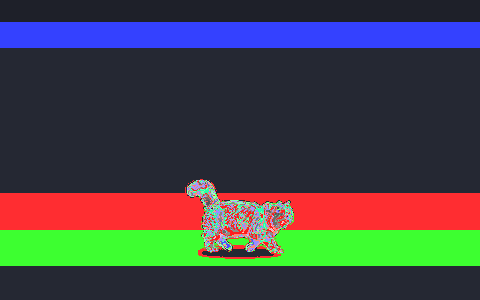

# desktop-cat 🐈

把自家猫的照片做成会溜达、会讨食、会玩逗猫棒的 Windows 桌面宠物。



纯 Win32 分层窗口实现（`ctypes` 调用 `UpdateLayeredWindow`），**不依赖任何 GUI 框架**——只装一个 Pillow 就能跑。逐像素透明、置顶、不抢焦点、CPU 占用约 2%。

## 功能

- 🚶 自己在屏幕底部溜达：走、跑、跳、打盹、发呆，到点还会自言自语冒气泡
- 🐟 **投喂小鱼干**：鱼干从天而降，猫走过去吃掉；有饱食度系统，饿了会头顶冒气泡讨食，饿的时候拒绝睡觉
- 🪶 **逗猫棒**：逗猫棒跟着你的鼠标走，猫追着冲刺扑跳；**把棒举高，它会真的跳起来够**
- 😺 左键点它 = 开心蹦 + 爱心；按住拖动 = 拎着走（放下自动回地面）
- 😴 睡觉是真实照片帧（自己家猫趴着睡的样子），睡中被投喂/拿逗猫棒会立刻醒来
- 🌙 深夜（23 点后）切换"夜话模式"，台词风格不同

## 运行

```bash
pip install pillow
python desktop_cat.py
```

可选参数：

```bash
python desktop_cat.py --size 160                  # 猫的像素高度（默认 120）
python desktop_cat.py --sprite 你的精灵图.png      # 换皮
python desktop_cat.py --sleep-sheet 睡觉图.png    # 睡觉状态用单独的精灵图
```

右键点猫打开菜单：投喂小鱼干 / 逗猫棒 / 听它说一句 / 大小 / 暂停 / 退出。

仅支持 Windows 10/11。开机自启：建一个 `.vbs`（`WScript.Shell.Run "pythonw ...", 0, False`）放进启动文件夹即可。

## 给自己家的猫做一个（精灵图规格）

程序只认一张 **8 列 × 9 行** 的精灵图，每个单元格 **192×208 px**，透明背景 PNG：

| 行 | 用途 | 帧数 |
|---|---|---|
| 0 | 待机 | 6 |
| 1 | 走/跑（程序按运动方向自动镜像） | 8 |
| 2 | 跑（本程序未使用，留空可复制第 1 行） | 8 |
| 3 | 跳跃 | 5 |
| 4 | （备用） | — |
| 5 | 睡觉（若未提供 --sleep-sheet 则用此行） | 8 |
| 6 | 开心/吃饭（挥爪） | 6 |
| 7-8 | （备用） | — |

空单元格会自动用前一帧补齐，不会闪烁。制作流程：

1. 给猫拍一组**固定机位、侧面、全身、干净地面**的照片/短视频（走路循环 10 秒够）
2. 逐帧抠图（rembg 的 isnet-general-use 效果不错）
3. 按上表排布成 8×9 网格，猫脚贴齐每格底部同一基线，缩放到统一高度
4. `python desktop_cat.py --sprite 你的图.png` 换皮

## 实现说明（写给想改的人）

- 每帧用 `UpdateLayeredWindow` 贴一张 32 位 BGRA DIB，透明度直接来自图片 alpha 通道
- 状态机：`idle/walk/run/jump/happy/eat/sleep`，各态有停留时长，到点重新决策；sleep 状态硬冻结（不换帧不位移）
- 逗猫棒/小鱼干渲染在**第二个点击穿透的分层窗口**上（`WS_EX_TRANSPARENT`），这样道具可以跑出猫窗范围、跟全屏鼠标
- 状态日志写在 `logs/cat_states.log`（每行带 x 坐标），调动画时可以拿它数值验收位移

## License

MIT
